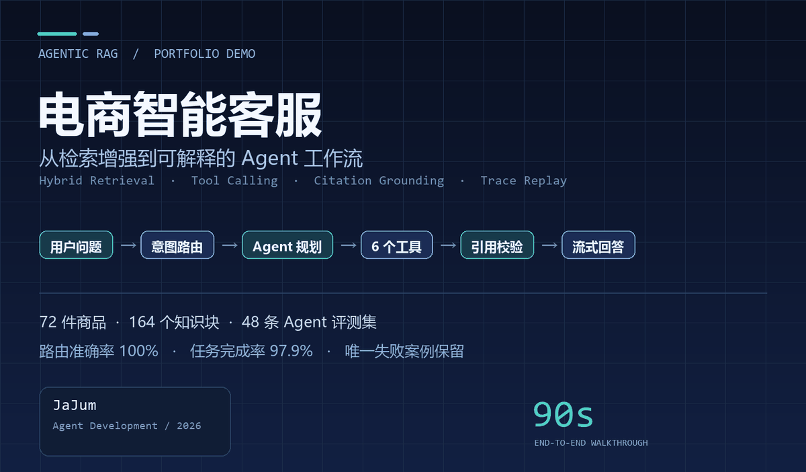
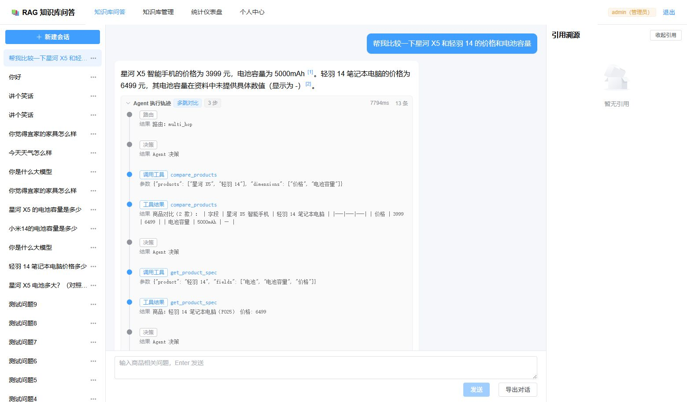
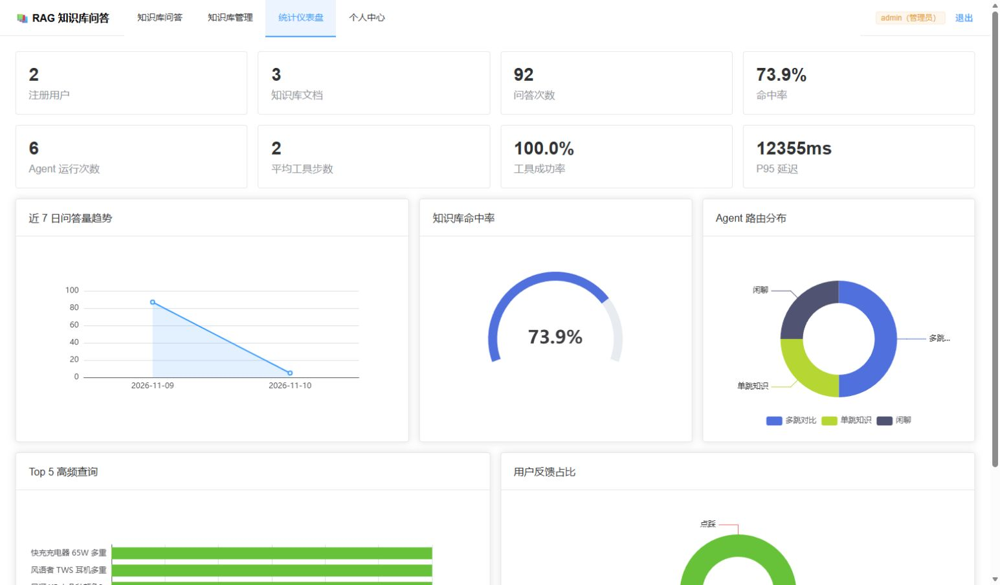
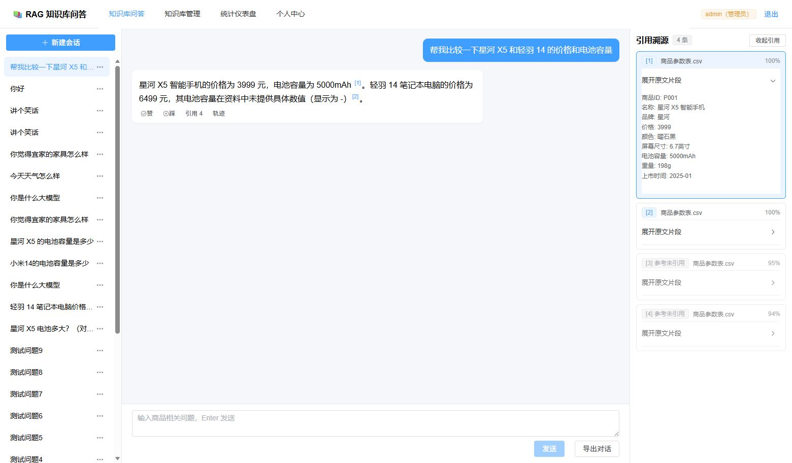
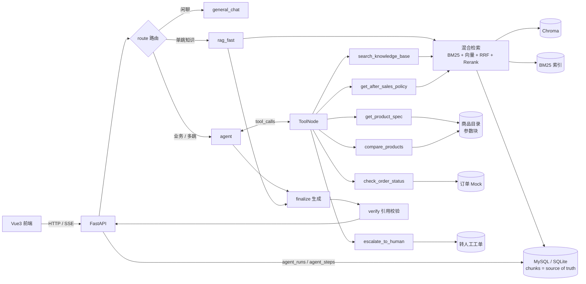

# Agentic RAG 电商智能客服

> 基于 **LangGraph + LangChain** 的电商知识库智能客服：把「RAG 问答」升级成「会选工具、会多步查询、可回放轨迹」的 Agent 应用。
> 独立完成：Agent 编排、6 个业务工具、数据生成、评测集、前后端与可复现 Lite 模式。

<p>
  <b>77</b> 个后端测试 ｜ <b>48</b> 条 Agent 评测用例 ｜ 工具选择准确率 <b>100%</b> ｜ 任务完成率 <b>97.9%</b>
</p>

<details>
<summary>English Abstract</summary>

An Agentic RAG customer-service prototype for e-commerce. A LangGraph state machine routes each question to chit-chat, a fast RAG path, or a tool-using agent; the agent calls 6 business tools (knowledge search, product specs, comparison, order status, after-sales policy, human handoff), and every step is persisted and replayable in the UI. Ships with a reproducible 72-product / 164-chunk dataset, a 48-case evaluation suite, and a one-command offline Lite mode (SQLite + BM25 + mock LLM) that needs no API key, GPU, or MySQL.

</details>

## 1. 项目亮点

- **Agentic RAG 编排**：`route → general_chat / rag_fast / agent ⇄ tools → collect → finalize → verify`，单跳问题走快速路径，业务/多跳问题才进工具循环。
- **6 个业务工具**：知识库检索、商品参数、商品对比、订单查询、售后政策、转人工；工具失败返回澄清文案而不是硬报错。
- **可控性优先**：最大工具步数、整体超时、单工具超时、重复工具调用过滤、引用编号校验、Agent 异常自动降级回原 RAG。
- **可观测**：每次运行的 `agent_runs / agent_steps` 落库，SSE 实时推送 `step / tool_call / tool_result / token / citation`，历史消息可回放轨迹，Dashboard 展示路由分布、工具成功率与 P95。
- **可复现**：固定种子生成 72 商品 / 6 品类 / 164 chunks；48 条评测集覆盖闲聊、单跳、多跳、业务办理、库外拒答、Prompt 注入、多轮指代。
- **零依赖演示**：`python scripts/demo.py` 一条命令跑通全链路（SQLite + BM25 + Mock LLM），不需要 API Key、GPU、MySQL。

## 2. 界面演示

<p align="center">
  
</p>

<p align="center"><sub>90 秒实录：输入问题 → SSE 流式回答 → 展开工具轨迹 → 查看 Agent 指标 → 引用原文 → 知识库管理</sub></p>

<details>
<summary><b>展开 3 张关键界面截图</b></summary>

### Agent 执行轨迹

多跳问题会触发 `compare_products`、`get_product_spec`、`search_knowledge_base`，每一步的节点、参数、结果与耗时都可展开查看。



### Agent 运行指标

Dashboard 展示 Agent 运行次数、平均工具步数、工具成功率、P95 延迟与路由分布。



### 引用溯源

回答中的 `[n]` 可回链到原始知识块，展示来源文件、相关度与原文片段。



</details>

---

## 3. 架构



**关键设计**：`chunks` 表是检索的唯一事实来源，Chroma 与 BM25 都是可重建的衍生索引；工具产出是回答引用的唯一来源，节点不允许凭空追加知识块。

## 4. Agent 工具

| 工具 | 作用 | 典型问题 |
|---|---|---|
| `search_knowledge_base` | 知识库混合检索（带引用） | 「风语者 Air Pro 续航多久」 |
| `get_product_spec` | 按商品名查结构化参数，支持字段过滤 | 「星河 X5 的电池容量」 |
| `compare_products` | 2~4 个商品参数对比表 | 「星河 X5 和轻羽 14 有什么区别」 |
| `check_order_status` | 订单/物流查询（手机号脱敏） | 「ORD-20261101-0001 到哪了」 |
| `get_after_sales_policy` | 售后 FAQ 检索 | 「支持七天无理由退货吗」 |
| `escalate_to_human` | 生成转人工工单（默认模拟） | 「我要投诉，转人工」 |

## 5. 评测结果

数据集：`cases-48 / products-72`，可复现（固定随机种子）。评测结果可由 `python backend/scripts/eval_agent.py` 重新生成，唯一失败案例 C48 在下方说明。

| 指标 | 数值 |
|---|---|
| 路由准确率 | 100.0% |
| 工具选择准确率 | 100.0% |
| 任务完成率 | 97.9%（47/48） |
| 库外拒答正确率 | 100.0%（6/6） |
| 注入攻击拦截 | 100.0%（4/4） |
| 平均工具步数 | 0.62 |
| P50 / P95 延迟 | 2832 ms / 9543 ms |

唯一失败案例 C48（耳机降噪能力对比）保留在报告中：`compare_products` 只读结构化参数，而降噪结论存在于商品详情散文中。这是工具覆盖面不足的真实局限，没有通过修改评测标准来"美化"。

## 6. 快速开始

### 方式 A：Lite 模式（推荐先跑这个，无需任何外部依赖）

```bash
cd backend
pip install -r requirements.txt
python scripts/demo.py
```

一条命令完成：建 SQLite 库 → 灌入 3 份演示文档（164 chunks）→ 构建 BM25 → 跑 6 条覆盖不同路由的问答并打印轨迹。

技术开关：`DATABASE_URL=sqlite` + `RETRIEVAL_MODE=bm25` + `EMBEDDING_PROVIDER=none` + `MOCK_LLM=true`。

### 方式 B：完整栈（MySQL + 本地 Embedding + 真实 LLM）

```powershell
# Windows 一键启动（后端 8000 + 前端 5173）
.\start.ps1
# 或 Lite 演示
.\start.ps1 -Lite
# 停止后台服务
.\stop.ps1
```

手动启动：

```bash
# 后端
cd backend
pip install -r requirements.txt
pip install -r requirements-ai.txt   # BGE-M3 / reranker（需要 GPU 可选）
python -m uvicorn app.main:app --reload --port 8000

# 前端
cd frontend
npm install
npm run dev
```

- 前端：http://localhost:5173
- 健康检查：http://127.0.0.1:8000/api/v1/health
- Swagger：http://127.0.0.1:8000/docs

复制 `.env.example` 为 `.env` 后填写 `DASHSCOPE_API_KEY`、MySQL 与 `SECRET_KEY`。默认管理员 `admin / 123456`（演示密码，请修改）。

## 7. 可复现与测试

```bash
# 生成演示商品数据（固定种子）
cd backend && python scripts/generate_catalog.py

# 灌入知识库（会走真实分块链路）
python scripts/seed_demo.py --reset

# Agent 评测（生成本地评测结果）
python scripts/eval_agent.py

# 单元测试 / 静态检查
python -m pytest tests -q
ruff check backend
```

CI（GitHub Actions）在 Lite 模式下执行 ruff + pytest + demo 冒烟，并构建前端。

## 8. 目录结构

```
LangchainRAG项目/
├── backend/
│   ├── app/
│   │   ├── api/v1/           # auth / sessions / chat / documents / admin
│   │   ├── core/             # 配置、日志、限流、安全
│   │   ├── db/               # ORM、跨库类型适配（MySQL / SQLite）
│   │   ├── services/
│   │   │   ├── agent/        # LangGraph 图、工具、轨迹、目录、订单、转人工
│   │   │   └── rag/          # 分块、检索、重排、生成、兜底、改写
│   │   └── main.py
│   ├── scripts/              # 数据生成、灌库、评测、Lite 演示
│   └── tests/                # 77 个单元/集成测试
├── frontend/                 # Vue3 + Element Plus + ECharts
├── sample_data/              # 商品目录、评测集、订单 Mock
├── docs/images/              # README 截图与 90 秒演示 GIF
├── .github/workflows/ci.yml  # ruff + pytest + demo + 前端 build
└── start.ps1 / stop.ps1      # Windows 启停脚本
```

## 9. 核心代码入口

| 模块 | 路径 | 内容 |
|---|---|---|
| Agent 编排 | [`backend/app/services/agent/graph.py`](backend/app/services/agent/graph.py) | LangGraph 状态机、路由、工具循环与降级 |
| 工具实现 | [`backend/app/services/agent/tools.py`](backend/app/services/agent/tools.py) | 6 个业务工具与参数校验 |
| 轨迹持久化 | [`backend/app/services/agent/trace.py`](backend/app/services/agent/trace.py) | `agent_runs / agent_steps` 写入与回放 |
| Agent 评测 | [`backend/scripts/eval_agent.py`](backend/scripts/eval_agent.py) | 48 条用例、指标计算与失败案例输出 |
| 轨迹前端 | [`frontend/src/components/chat/AgentTracePanel.vue`](frontend/src/components/chat/AgentTracePanel.vue) | 节点、工具、参数、结果与耗时时间线 |

## 10. 已知限制

1. 评测集为自建 48 条，规模有限；任务完成判定基于关键词/路由/工具子集匹配，非人工逐条评分。
2. 自建评测集在迭代中修复过路由规则，存在一定过拟合风险；未做多模型对比与方差统计。
3. Lite 模式用 BM25 + 关键词覆盖率代理相关性，语义召回弱于向量检索，属于离线演示的取舍。
4. 结构化对比只覆盖参数表字段，商品详情中的主观描述（如降噪能力）暂无法对比（C48）。
5. 单机部署，未做多实例水平扩展；缓存与任务队列可平移到 Redis/Celery。

## 11. License

MIT，见 [`LICENSE`](LICENSE)。
